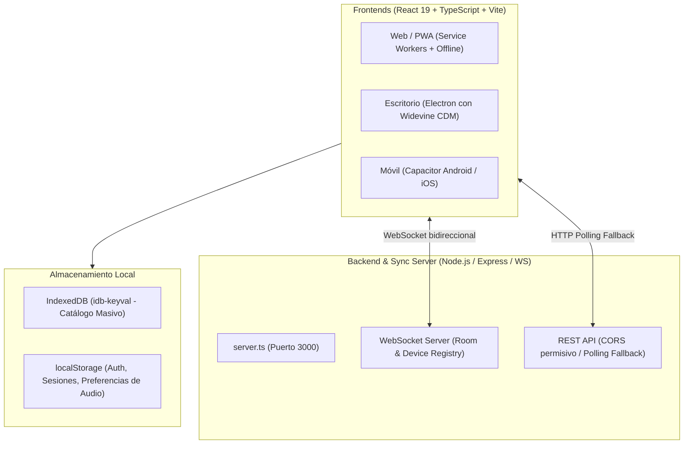

# Documento de Transferencia Técnica — CineCast TV
**Audiencia:** Director Técnico / CTO / Tech Lead  
**Fecha:** Noviembre 2026  
**Repositorio Oficial:** [github.com/FacundoRomero1/cinecast](https://github.com/FacundoRomero1/cinecast)  
**Rama principal:** `main`

---

## 1. Visión General del Producto
**CineCast TV** es un ecosistema multimedia de entretenimiento enfocado en Smart TVs, PCs y dispositivos móviles que unifica:
* **Catálogo masivo bajo demanda:** Películas, series y anime con audio latino verificado (+10.000 títulos).
* **Televisión en Vivo (IPTV):** Canales lineales vía HLS (`hls.js`).
* **Hubs de terceros embebidos:** YouTube TV y Spotify Web Player.
* **Control Remoto & Cast en tiempo real:** Uso de teléfonos inteligentes como touchpad, control remoto y emisor de contenido hacia una pantalla principal (PC o Smart TV).

---

## 2. Arquitectura de Sistemas y Stack Tecnológico



### Componentes Principales:
* **Frontend:** React 19, TypeScript, Vite, Tailwind CSS v4, Motion (Framer Motion), Lucide Icons, `react-virtuoso` (listas virtualizadas de alto rendimiento).
* **Multiplataforma:**
  * **Desktop:** `castlabs-electron` (`v44.5.1+wvcus`) para soporte nativo de **Google Widevine DRM**.
  * **Mobile:** `@capacitor/core` y `@capacitor/cli` (`v8.5.3`).
  * **Web/PWA:** Service Worker (`sw.js`) y `manifest.webmanifest`.
* **Backend de Sincronización:** `server.ts` con Express y `ws` (WebSockets).

---

## 3. Puntos Críticos y Decisiones de Ingeniería Clave

### A. Sincronización Multi-dispositivo y Control Remoto (Dual-Screen)
* **Mecanismo:** Basado en salas (`rooms`) y registros de dispositivos (`screen`, `remote`, `hybrid`).
* **Resiliencia de Red:** La sincronización de reproducción y comandos táctiles usa **WebSockets** como canal prioritario. En entornos restringidos o cortes de socket, conmuta automáticamente a **Long-Polling HTTP** con buffer circular de comandos y desduplicación por `seenCommandIds`.
* **Sincronización en la misma máquina:** Soporta `BroadcastChannel` y storage events para comunicación instantánea entre pestañas/ventanas sin carga adicional de red.

### B. DRM y Reproducción de Medios Protegidos (Spotify & Widevine)
* **Problema:** El reproductor web oficial de Spotify (`open.spotify.com`) requiere CDM Widevine de Google. Las compilaciones estándar de Electron no lo incluyen por licenciamiento.
* **Solución implementada:** Se configuró el fork especializado **`castlabs/electron-releases`** en `package.json` (`electronVersion: 44.5.1+wvcus`), el cual incluye la integración de Widevine con VMP (Verified Media Path) para Windows, Mac y Linux.
* **Fallback:** Si el entorno no soporta Widevine, se implementó un bypass para abrir Spotify directamente en el navegador del sistema operativo.

### C. Estrategia de Caché y Persistencia en el Cliente
* **IndexedDB para Catálogo:** Para manejar más de 10.000 entradas sin saturar la cuota de 5 MB de `localStorage` ni bloquear el hilo de renderizado (`main thread`), se usa **`idb-keyval`** en `catalogCache.ts`.
* **localStorage para estado liviano:** Utilizado solo para Device IDs, Room IDs, tokens de Spotify/Google y preferencias de audio/subtítulos.

---

## 4. Estructura del Código

```text
c:\PROYECTOS\cinecast\cinecast\
├── electron/              # Configuración y preload del proceso principal Electron
│   ├── main.cjs           # Gestión de ventanas, permisos de audio y DRM
│   └── preload.cjs        # ContextBridge (window.electronAPI)
├── public/                # Assets estáticos, Service Worker, catálogo JSON
├── src/
│   ├── components/        # Componentes UI (Player, RemoteControl, SpotifyHub, etc.)
│   ├── context/           # Contextos globales (BookmarksContext)
│   ├── data/              # Mapas de audio latino, canales y metadatos
│   ├── hooks/             # Custom hooks (useVideoPlayer, useMediaCatalog, etc.)
│   ├── pages/             # Vistas de la aplicación (Home, Bookmarks, Admin)
│   ├── services/          # Lógica desacoplada (iptvService, deviceSync, catalogCache)
│   └── types.ts           # Definiciones estrictas de TypeScript
├── capacitor.config.ts    # Configuración de empaquetado móvil Android / iOS
├── server.ts              # Servidor Node.js con Express y WebSockets
└── vite.config.ts         # Configuración del bundler Vite
```

---

## 5. Deuda Técnica y Próximos Desafíos donde se Requiere su Liderazgo

1. **Unificación a TypeScript Puro:**
   * Aproximadamente 16 archivos (como `App.jsx`, `HomePage.jsx`, `BookmarksContext.jsx`) siguen en JS/JSX. Conviene completar la migración a `.tsx` para garantizar cobertura total de tipos y autocompletado en el IDE.
2. **Pipeline de CI/CD (GitHub Actions):**
   * Configurar flujos de trabajo para:
     * Linting y validación de tipos (`tsc --noEmit`, `oxlint`).
     * Compilación automática de artefactos (`.exe` con NSIS para Windows, `.apk` con Capacitor para Android).
3. **Optimización de Proveedores de Streaming:**
   * Consolidar la estrategia de rotación y verificación de enlaces HLS/IPTV en `iptvService.ts` para mitigar caídas de streams en vivo.
4. **Seguridad y Producción:**
   * Endurecer las políticas de CORS y autenticación en `server.ts` antes de exponer el servidor de sincronización en red pública.

---

## 6. Comandos Rápidos de Trabajo

```bash
# Instalar dependencias
npm install

# Iniciar servidor backend + HMR de Vite
npm run dev

# En otra terminal: Iniciar cliente Electron de escritorio
npm run electron

# Verificar tipado de todo el proyecto
npm run lint

# Generar instalador de producción para Windows
npm run build:installer
```
